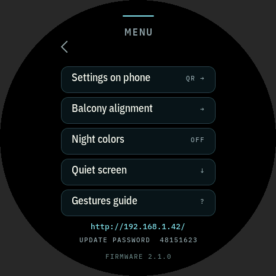
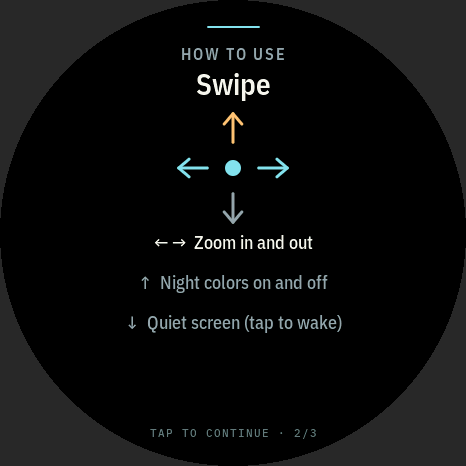
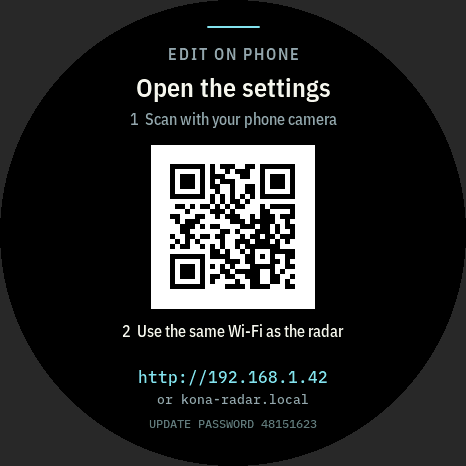
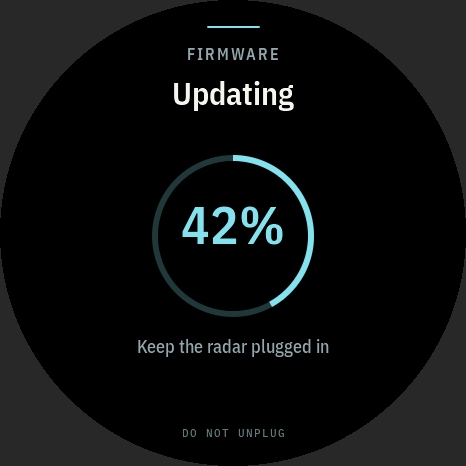

# Kona Radar

A glance-then-look-up flight tracker for the **Waveshare
ESP32-S3-Touch-AMOLED-1.43**. It hangs on a balcony with a view of Kona
International Airport (KOA) and shows nearby aircraft, using free public ADS-B
data over Wi-Fi. The scope is centered on **you**, and the top of the screen
is the direction you face, so an aircraft drawn up and to the right is up and
to the right when you look out. The screen wakes when a plane is about to
land, and when it is about a minute out the screen says which way to look.

| Radar (view up, 10 NM) | 5 NM, departure selected | Aircraft detail | Look-up alert |
| --- | --- | --- | --- |
|  |  |  |  |
| **Phone setup** | **Night** | **Quiet idle** | **Balcony alignment** |
|  |  |  |  |
| **Menu** | **Gesture guide** | **Settings on phone (by IP)** | **Firmware update** |
|  |  |  |  |

*These are screenshots from the host simulator, which runs the real UI code
with the design's example traffic around a made-up observer. The gray
corners are outside the round panel. The UI follows the design in
[`docs/design/`](docs/design/DESIGN.md).*

- [Hardware](#hardware)
- [Flashing](#flashing)
- [First-time Wi-Fi setup](#first-time-wi-fi-setup)
- [Your location (and keeping it private)](#your-location-and-keeping-it-private)
- [Using the radar](#using-the-radar)
- [Flight cues](#flight-cues)
- [Data source](#data-source)
- [Configuration](#configuration)
- [Firmware updates over Wi-Fi](#firmware-updates-over-wi-fi)
- [AMOLED burn-in protection](#amoled-burn-in-protection)
- [Code layout and the UI design](#code-layout-and-the-ui-design)
- [Tests and simulator](#tests-and-simulator)
- [What to check first on real hardware](#what-to-check-first-on-real-hardware)
- [Licenses and credits](#licenses-and-credits)

## Hardware

The board is the ESP32-S3R8 version: 16 MB flash and 8 MB octal PSRAM. The
display and touch details below come from Waveshare's
[wiki](https://www.waveshare.com/wiki/ESP32-S3-Touch-AMOLED-1.43) and its
official demo package (`ESP32-S3-AMOLED-1.43-Demo`, `Arduino/examples/07_LVGL_Test`).

| Part | What the firmware does |
| --- | --- |
| 1.43" 466×466 AMOLED, QSPI | Waveshare ships this board with **either an SH8601 or a CO5300** controller. At boot the firmware reads ID register `0xDA` over bit-banged SPI, as Waveshare's demo does. `0x86` means SH8601; anything else means CO5300, which needs a 6-pixel column offset. Pins: CS 9, SCLK 10, D0–D3 11–14, RST 21, AMOLED_EN 42. The pixel clock is 40 MHz. The driver is Espressif's `esp_lcd_sh8601` (vendored), which handles both controllers. |
| FT3168 capacitive touch, I2C `0x38` | Polled at 400 kHz on SDA 47 / SCL 48. Touch INT and RST are not connected to the ESP32. See [Touch notes](#touch-notes). |
| QMI8658 IMU, PCF85063 RTC, ETA6098 PMIC, microSD | Not used yet. The clock comes from NTP. |
| BOOT button (GPIO 0) | Hold it for 5 s while running to reset Wi-Fi, the same as holding the screen. |

### Touch notes

These findings come from Waveshare's demo package V3
(`ESP-IDF/07_LVGL_Test/components/touch_bsp/touch_bsp.c`,
`Arduino/examples/07_LVGL_Test/FT3168.cpp`, `lcd_config.h`), the board
schematic (`ESP32-S3-Touch-AMOLED-1.43-Schematic.pdf`, connector J9), and the
FocalTech `DATA_SHEET_FT3168.pdf`:

- **Controller and pins.** The controller is an FT3168 at `0x38` on SDA 47 /
  SCL 48, the same bus as the RTC (`0x51`) and the IMU (`0x6B`). The touch
  INT and RST pins on J9 are not connected: both demos use −1, there is no
  IO expander, and the controller is powered from 3V3 with 10 kΩ pull-ups.
  Panel enable (`OLED_EN`, R9) is not fitted either.
- **Start-up order.** The controller needs at least 70 ms after power-up
  (datasheet Tpon) and 5 ms after reset. Waveshare's IDF demo starts touch
  after the panel, and the firmware does the same.
- **Why it went missing.** In *Monitor* (low-power) mode the FT3168 stops
  answering I2C until it is touched, especially after traffic to other
  addresses on the bus (datasheet §2.3). Arduino's `Wire` on IDF 5.5 reports
  that NACK as `ESP_ERR_INVALID_STATE` / `Error 259`. That explains both
  `FT3168 touch not responding at 0x38` on the first boot and the errors about
  12 s in, when the chip had dozed off.

What the firmware does about it:

- It uses its own thread-safe I2C bus (`src/hal/i2c_bus.*`, IDF
  `i2c_master` with a mutex) rather than `Wire`.
- It probes `0x38`, then `0x15` (CST816) as a fallback. If the controller
  isn't there, it resets the panel module once and tries again.
- Once found, it writes *stay active* (`0x86 = 0`, `0xA5 = 0`) and logs the
  chip, firmware and vendor IDs.
- It logs an I2C scan at boot, after the touch controller is configured.
- If the controller drops out, it re-probes every 100 ms and re-applies the
  settings every 10 s. It warns at most once a minute instead of flooding
  the log.

Graphics use **LVGL 8.4** with two 466×32-line DMA buffers in internal RAM.
LVGL's own heap (objects, styles, label text, about 53 KB in ~1,000 small
blocks) is in PSRAM (`include/lv_mem_hooks.h`), so it doesn't compete with
Wi-Fi and TLS for internal RAM.

**Screen rotation** (0°, 90°, 180°, 270°) is done in software in the flush
callback. The CO5300 can't do it in hardware: its MADCTL register only mirrors
X and Y and has no row/column exchange. Arduino_GFX's `Arduino_CO5300::setRotation`
says "CO5300 does not support rotation", and the SH8601-family driver here
returns *not supported* for `swap_xy`. A mirrored 180° would also need a
different column offset that isn't documented for this module. While
rotated, LVGL renders single-buffered and the flush rotates each block into
the second buffer, which the panel then receives. Rendering still overlaps
the transfer, and no third buffer is needed. The rounder keeps areas on even
start / odd end, and with the even 466 px size that holds after rotation too.
Touch points get the inverse mapping before LVGL sees them, so taps and
swipe directions follow the turned picture. Rotation only makes up for how the board
is mounted. The radar's own "up" (the direction you face, or north) is a
separate setting and stays as it is. The radar background (coastline, rings, runway, view cone) is
pre-rendered into a 434 KB PSRAM layer and redrawn only when the range or
orientation changes. Text uses IBM Plex fonts converted to 4-bit LVGL bitmaps.

## Flashing

1. Install [PlatformIO](https://platformio.org/platformio-ide). Use either the
   VS Code extension or the CLI (`pipx install platformio`).
2. Connect the board with a USB-C **data** cable.
3. From this folder, run:

   ```bash
   pio run -t upload        # build and flash (first build downloads the toolchain)
   pio device monitor       # optional: serial log at 115200 baud
   ```

   If the upload can't find the board or fails to connect, put it in download
   mode: hold **BOOT**, tap **RST**, release **BOOT**, then run the upload again.
   Press **RST** once flashing finishes.

After this first USB flash, later updates can go over Wi-Fi (see
[Firmware updates over Wi-Fi](#firmware-updates-over-wi-fi)).

The build uses the [pioarduino](https://github.com/pioarduino/platform-espressif32)
platform 55.03.312 (Arduino-ESP32 3.3.12 on ESP-IDF 5.5) and a board definition
in `boards/`. The serial log goes over the USB port (USB CDC on boot).

## First-time Wi-Fi setup

Nothing to install: it only takes a phone camera.

| 1. Scan | 2. Joining | 3. Checking for flight data | 4. Done |
| --- | --- | --- | --- |
|  |  |  |  |

1. **Plug the radar in.** With no network saved it shows **Set up with your
   phone** and a QR code.
2. **Point your phone's camera at the code** and tap *Join "Kona-Radar-XXXX"*.
   On Android, if the camera ignores it, go to Settings › Wi-Fi and tap the QR
   icon. The network name and password (`look-up-NNNN`) are also printed below
   the code for typing by hand. The screen then shows **Phone joined**.
3. **The sign-in page opens on the phone by itself.** If it doesn't, open
   `http://192.168.4.1/` (shown on the screen as *No page?*).
4. **Pick your home network and type its password.** Optionally paste your
   balcony's location too (see the next section); you can also skip it and
   add it later.
5. **Wait about 10–30 seconds.** The radar first joins the network
   (**Joining Wi-Fi**), then checks that flight data actually downloads
   (**Going online**). Both the phone and the radar report the result:
   - **You're connected**: tap **OPEN RADAR** or wait a few seconds.
   - **Couldn't connect**: wrong password, the network wasn't found (it must
     be 2.4 GHz; the ESP32 has no 5 GHz radio), or the router refused the
     connection. Fix it on the phone, which is still connected, or tap **TRY AGAIN**.
   - **No internet**: the Wi-Fi password was right and is saved, but no
     flight data came through. **TRY AGAIN** checks again.
6. Your phone goes back to its usual Wi-Fi. The radar remembers the network
   and reconnects by itself after power cuts or router restarts. The
   **You're connected** screen and the radar's footer (for 20 s) show its IP
   address.

### Several networks

The radar remembers **up to 8 networks**, for example home, a hotspot and
the neighbor's guest Wi-Fi:
- At power-on it scans and joins the **strongest saved network in range**.
  If that fails it tries the next one; networks not seen in the scan are
  tried last.
- If the connection drops and doesn't come back within a few seconds, it
  scans again and moves to another saved network. When none works it keeps
  retrying, backing off from 10 s to a minute.
- **Phone setup adds a network** to the list; it never replaces the others.
  If setup was opened by mistake while networks are saved, it closes again
  after 5 minutes without a phone and goes back to them.
- The settings page lists the saved networks with signal strength and which
  one is in use. You can remove them or add new ones; nearby networks are
  suggested. Passwords are never shown or sent back.
- A network saved by firmware 2.0 or older is moved into the list
  automatically.

**Starting over: hold anywhere on the screen for 5 seconds**, or hold the BOOT
button. A ring fills up while you hold, and letting go cancels. This forgets
*all* saved Wi-Fi networks and opens phone setup; your location, view and
display settings stay. If no saved network can be reached after power-on,
the radar shows **Wi-Fi not found**, keeps retrying in the background, and
offers **SET UP WI-FI**.


### How this matches the design

The design (`docs/design/DESIGN.md`, *First-time connection*) chose **QR →
temporary setup Wi-Fi → captive portal**, with no app or account. The
firmware was already built on that flow, so the two are reconciled rather
than replaced. To match the design:

- **Setup network.** It is now called `Kona-Radar-XXXX`, using the last two
  bytes of the MAC. Its password is `look-up-NNNN`, picked at random on first
  boot and kept in NVS, so a printed or remembered QR code stays valid. It
  used to be derived from the MAC address, which anyone could recompute.
- **Separate internet check.** Joining the Wi-Fi and getting flight data are
  separate steps. *Connected* is only shown after the first successful
  download, and "no internet" is reported apart from "wrong password", as the
  design asks.
- **Failure reasons.** Wrong password, network not found and router refused
  each get their own wording, reusing the failure layout.
- **5-second reset.** The **5 s hold anywhere** replaces the previous
  long-press settings menu and its Change Wi-Fi button. It forgets only the
  Wi-Fi.
- **Location step.** The portal asks for the observer location and facing
  bearing, as the design's phone flow does, but the step is optional so that
  joining Wi-Fi never gets stuck on a coordinates question.

The design mentions BLE as a possible optional second transport. It isn't
implemented, for the reasons in the next section.

### Why a captive portal with a QR code

| Option | What the person has to do | Problem |
| --- | --- | --- |
| **SoftAP captive portal + Wi-Fi QR code (chosen, and the design's choice)** | Point the camera, tap join, pick the network, type the password | None that matters. It works on any phone with no app, using the camera and the captive-portal page every phone already has. |
| Espressif BLE provisioning (ESP BLE Prov app + QR) | Install "ESP BLE Provisioning" from the app store, scan, pick the network | Needs a niche developer app; adds the BLE stack (~300 KB flash, RAM) |
| Improv Wi-Fi over BLE | Open a web page in Chrome, connect over Web Bluetooth | **Web Bluetooth doesn't work on iPhone or iPad** (Safari has none, and every iOS browser uses Safari's engine) |
| Improv Wi-Fi over serial | Plug into a computer and use a web flasher page | Needs a computer and a Chromium browser; no good for re-setup on a balcony |

The chosen flow avoids the usual captive-portal problems:
- The setup network has a password, shown on screen and in the QR code, so
  neighbors can't join it.
- The radar answers every OS connectivity check (Android, iOS/macOS, Windows,
  Firefox) and advertises the portal through DHCP, so the page pops up by
  itself. The IP address is on screen as a fallback.
- The password is tested before it is saved, and errors are in plain language.
- The access point stays up for 10 s after success so the phone sees the result.

## Your location (and keeping it private)

The firmware ships with a **neutral default: the observer is KOA itself**.
In that state the radar is centered on the airport, the top of the screen is
north, the footer says **SET YOUR LOCATION ON PHONE**, and the alignment
screen says **Set your location**. Nothing about where the radar actually
hangs is compiled into the public firmware.

| Location not set | Alignment, location not set |
| --- | --- |
|  |  |

There are three ways to give the radar its real location. None of them
involves committing it to the repository:

1. **During Wi-Fi setup**, in the optional *Your balcony* step of the portal.
2. **Any time later** on the settings page. On the radar, tap **MENU**, then
   **Settings on phone**, for a QR code with the page's address
   (`http://<ip>/`; Android phones don't resolve `kona-radar.local`). The
   alignment screen's *TAP HERE TO EDIT ON PHONE* opens the same page.
3. **At build time**, for your own builds only:

   ```bash
   cp include/config.local.example.h include/config.local.h   # gitignored
   # edit RADAR_OBSERVER_LAT / RADAR_OBSERVER_LON / RADAR_VIEW_BEARING_DEG
   pio run -t upload
   ```

   `include/config.h` includes `config.local.h` first when it exists, and any
   macro there overrides the factory default. `.gitignore` also excludes
   `*.local.json`.

Values set from the phone are stored in NVS on the device and survive
firmware updates. Restoring factory settings goes back to the build's
defaults.

To get the coordinates, long-press the spot in Google or Apple Maps and copy
the two numbers. For the facing direction, keep **toward the airport** (the
default) or enter a measured compass bearing in degrees true. The alignment
screen shows the result: **Face the airport · 260°** when the airport is
straight ahead, otherwise how far left or right of your view it is.

**About the design files.** The original mockups were drawn around a real
balcony. The copy in `docs/design/` has been re-rendered around a made-up
placeholder observer (19.7470, −155.9940, about 3 NM east of KOA, facing it at
260°). The coordinates are not the only thing replaced: in a radar picture
the airport's position relative to "YOU" gives the observer away, so the
screens themselves were re-rendered too. The simulator uses the same
placeholder.

## Using the radar

On first start a three-page **gesture guide** explains the taps and swipes.
Tap to go through it. It can be reopened from **MENU › Gestures guide**.

The small **MENU** button at the top right is the way to everything that is
otherwise a gesture:
- **Settings on phone**: a QR code and the IP address, plus the firmware
  update password.
- **Balcony alignment**.
- **Night colors**, on or off.
- **Screen rotation**: each tap turns the picture 90° clockwise, live. The
  menu stays open, so keep tapping until the text reads upright. The setting
  is saved, and it's also on the settings page.
- **Quiet screen**.
- **Gestures guide**.

The menu also shows the address and firmware version. For a few seconds
after the guide, on the first radar view and after tapping empty sky, small
hints at the screen edges show what the swipes do.

| Where | Gesture | What happens |
| --- | --- | --- |
| **MENU** (top right) | tap | menu (see above); ‹ or swipe right goes back |
| Range text (`· 10 NM`, right half of the header) | tap | 5 → 10 → 20 NM, wrapping |
| Empty radar | swipe left / right | zoom out / in |
| Title or `VIEW 260°T` (left half of the header) | tap | Balcony alignment: bearing, distance to the airport, **NORTH UP / VIEW UP** switch, and a QR code for the phone settings |
| Aircraft icon or label | tap | select it; its summary appears in the bottom dock |
| Selected aircraft, or the dock | tap | aircraft detail |
| Overlapping aircraft | tap again | cycles through the cluster instead of guessing |
| Empty sky | tap | back to the automatic focus (the next likely arrival) |
| Detail / alignment | tap ‹ or swipe right | back to the radar |
| Look-up alert | tap | dismiss and open that aircraft's detail |
| Empty radar | swipe up (a long, clearly vertical stroke) | day ⇄ night colors until the next scheduled change; a notice says which, and swiping up again undoes it |
| Empty radar | swipe down (long, vertical) | quiet idle screen; tap to wake |
| Anywhere | hold 5 s | reset Wi-Fi only (see above) |

On the scope:
- Rings are at a third, two thirds and the full range, measured from you.
- Ticks mark every 15°, and **N** marks true north. The cyan triangle at the
  top and the shaded cone are your view.
- The runway is drawn from the FAA threshold coordinates, with its numbers.
- Aircraft are drawn as silhouettes pointing along their track, with three
  trail dots showing where they came from.
  - Cyan is traffic, sage is a departure (↑ after the name), and amber is the
    focused aircraft, which gets a double ring.
  - Helicopters have their own icon.
  - Coral means an emergency squawk. Grey means stale data.
- A dashed amber line joins a likely arrival to its runway threshold.
- The header shows the aircraft count in range, and **+N OUTSIDE** for
  aircraft just beyond the outer ring.
- The footer shows the data source and freshness, for example `ADSB.FI ·
  LIVE`, `STALE 45s` or `WI-FI LOST · RECONNECTING`.

The bottom dock always says what matters most right now:
- `APPROACHING KOA · ~3 MIN · RIGHT 77°` for the next likely arrival,
- `DEPARTING SWA250 ↑ 2,300 FT` for a selected departure,
- otherwise altitude and speed.

The aircraft detail screen adds operator and type, a role tag (`LIKELY
ARRIVAL · RWY 17`, `HELICOPTER`, `STALE`…), altitude, ground speed, vertical
rate, track, squawk, and where to look: `RIGHT 77° · ~3 MIN` and its
elevation above the horizon (`2° UP`).

## Flight cues

The cues are heuristics computed in `lib/radar_core/src/traffic.cpp`. They are
not ATC data:

- **Likely arrival.** All of these must hold:
  - the track is within 25° of a runway's landing direction, before the
    threshold and up to 15 NM out;
  - it is close to the extended centerline, with tolerance growing with
    distance;
  - altitude is on a plausible approach profile, and the aircraft is
    descending or already low;
  - it is getting closer between reports.

  The ETA is the distance to the threshold divided by ground speed, shown
  with `~`.
- **Likely departure.** Climbing at 300 ft/min or more, below 8,000 ft, past
  the far end of the runway, and close to the centerline.
- **Helicopter.** Category A7 or a known helicopter type.
- **Stale data.** Colors are muted after 30 s without a position. ETAs and
  alerts are dropped after 60 s. The aircraft is removed after 180 s.
- **Look-up alert.** Shown once per aircraft when a likely arrival in range
  is 75 s or less from the threshold. It wakes the screen and can be turned
  off on the settings page. The direction is relative to the way you face,
  for example `LOOK RIGHT · 47° from your balcony view`, with the true
  bearing underneath (`NW 307°T`). There is no compass on the board, so this
  relies on the facing bearing being right.
- **Wake for landings.** When an aircraft is predicted to land within
  **10 minutes** (settings page, 0 = off), the screen wakes. It wakes from
  the quiet screen, from screen-off and from a swipe down, and stays on until
  the aircraft lands. The wake happens once per aircraft, so swiping it quiet
  again sticks until the next arrival. Night brightness still applies.
  Beyond the 15 NM final-approach cue above, this uses a rougher **inbound**
  estimate: not climbing, descending or already low for the distance, and
  heading within 60° of the airport. The time is the distance plus a little
  for joining the approach, at a little under the current ground speed.

## Data source

There is no local receiver, so positions come from community ADS-B
aggregators. No API key is used.

| Source | Used as | Limits / terms | Notes |
| --- | --- | --- | --- |
| [adsb.fi open data](https://github.com/adsbfi/opendata) `https://opendata.adsb.fi/api/v3/lat/{lat}/lon/{lon}/dist/{nm}` | **Primary** | 1 request/s on public endpoints, radius up to 250 NM. **Personal, non-commercial use only; attribution required** ("Data: adsb.fi"). | Also includes the aircraft type description and operator |
| [adsb.lol](https://api.adsb.lol/) `https://api.adsb.lol/v2/point/{lat}/{lon}/{nm}` | Automatic fallback | Data under [ODbL 1.0](https://opendatacommons.org/licenses/odbl/summary/); "dynamic" limits, none published; may require a (free) key in the future | Same readsb JSON format |
| airplanes.live | Not used | Returned **HTTP 403** to anonymous requests when tested and asks API users to email first | |
| OpenSky Network | Not used | 400 API credits/day anonymous; OAuth client needed for more; non-commercial research terms | Credit budget too small for a 5 s refresh |

**How the firmware uses them:**
- Every 5 s by default (never faster than every 2 s), it requests a circle
  around the observer of twice the displayed range, at least 25 NM. That
  covers the "+N outside" count and arrivals still well out on final. With
  wake for landings on, the circle grows to about 4.5 NM per minute of the
  window (50 NM for the default 10 minutes).
- It runs in a background task on core 0 over HTTPS (with the built-in CA
  bundle) and reuses the connection between requests.
- On HTTP 429 it waits 60 s. On other errors it backs off exponentially, up
  to 60 s.
- After 3 failures in a row it switches to the other source, and drifts back
  to the preferred one later.

**Coverage near KOA is the main limitation, not the firmware.** The
aggregators depend on volunteer receivers, and the Big Island's west side has
few. In the snapshot used for the test fixtures:
- adsb.fi had 37 aircraft within 150 NM of KOA, but only **2 within 25 NM**.
- adsb.lol had **none within 50 NM**.

Jets at altitude near Kona show up. Low aircraft on approach, helicopters, and
ground traffic often don't, which also limits the arrival cues. A cheap local
feeder (an RTL-SDR dongle on a Raspberry Pi, feeding adsb.fi or adsb.lol)
anywhere around Kona would improve coverage for everyone.

## Configuration

### From a phone, no reflashing

When the radar is online, open **`http://<its IP>/`** on a phone or computer
on the same Wi-Fi. Tap **MENU** on the radar for the address and a QR code.
`http://kona-radar.local/` also works on Macs, iPhones and most computers,
but many Android phones (Samsung included) don't resolve `.local` names.

| Setting | Default |
| --- | --- |
| Balcony location (paste "lat, lon") and height | not set (= the airport), 50 ft |
| Top of the screen | the direction you face (view up); or north |
| You face | toward the airport (auto); or a compass bearing |
| Range | 10 NM (5 / 10 / 20) |
| Screen rotation (how the radar is mounted) | 0° (also MENU › Screen rotation) |
| Look-up alerts | on |
| Brightness | 80% |
| Quiet screen after / its brightness | 90 s / 40% |
| Screen off after quiet for | 900 s |
| Wake for landings | 10 minutes before touchdown (0 = off) |
| Also wake when any plane is within | 0 NM = off |
| Night colors | by the hours 19:00–06:00, night brightness 35% (or never / always) |
| Wi-Fi networks | list, add, remove (up to 8) |
| Firmware | version, link to the update page |
| Airport and label, data source, refresh | KOA 19.738765, −156.045631; adsb.fi; 5 s |

Settings are stored in NVS flash and survive power cuts and firmware updates.
Only values you change are stored, so a new firmware with different defaults
still updates everything you never touched. **Restore factory settings**
clears your changes and keeps the Wi-Fi. The page has no password: anyone on
your home Wi-Fi can change settings, which is normal for this kind of gadget.

### Build-time defaults

All factory defaults are in [`include/config.h`](include/config.h). Override
them in the gitignored `include/config.local.h` (see above) or with build
flags in `platformio.ini`, for example `-DRADAR_DEFAULT_RANGE_NM=20`.

| Macro | Default | Meaning |
| --- | --- | --- |
| `RADAR_CENTER_LAT` / `_LON` / `_NAME` | 19.738765 / −156.045631 / "KOA" | Airport |
| `RADAR_OBSERVER_LAT` / `_LON` / `_ALT_FT` | the airport / 50 | Where the radar hangs (the airport = not set) |
| `RADAR_VIEW_BEARING_DEG` | −1 | Facing bearing, degrees true (−1 = toward the airport) |
| `RADAR_NORTH_UP` | 0 | 1 = north at the top instead of the view |
| `RADAR_SCREEN_ROTATION` | 0 | Mounting, quarter turns clockwise |
| `RADAR_DEFAULT_RANGE_NM` / `RADAR_RANGE_STEPS_NM` | 10 / {5, 10, 20} | Range |
| `RADAR_REFRESH_INTERVAL_S` / `RADAR_PRIMARY_SOURCE` | 5 / 0 | Download interval; 0 adsb.fi, 1 adsb.lol |
| `RADAR_STALE_MUTE_S` / `_NO_ETA_S` / `_AFTER_S` | 30 / 60 / 180 | Stale data handling |
| `RADAR_ALERT_ETA_S` | 75 | Look-up alert |
| `RADAR_LANDING_WAKE_MIN` | 10 | Wake for a landing this many minutes out (runtime setting; 0 = off) |
| `RADAR_DEFAULT_BRIGHTNESS` | 80 | Percent |
| `RADAR_IDLE_DIM_S` / `RADAR_IDLE_BRIGHTNESS` / `RADAR_BLACKOUT_S` | 90 / 40 / 900 | Quiet screen and screen-off |
| `RADAR_WAKE_RANGE_NM` | 0 | Also wake for any aircraft this close (0 = off) |
| `RADAR_NIGHT_MODE` / `_START_H` / `_END_H` / `RADAR_NIGHT_BRIGHTNESS` | 0 / 19 / 6 / 35 | Night colors (0 by hours, 1 never, 2 always) |
| `RADAR_PIXEL_SHIFT_S` / `_MAX` | 60 / 2 | Burn-in pixel shift |
| `RADAR_AP_PREFIX` / `RADAR_AP_PASS_PREFIX` / `RADAR_HOSTNAME` | "Kona-Radar" / "look-up-" / "kona-radar" | Setup network and mDNS name |
| `RADAR_ONLINE_CHECK_S` / `RADAR_RESET_HOLD_S` | 30 / 5 | Setup internet check; hold time for the Wi-Fi reset |
| `RADAR_TIMEZONE` | "HST10" | POSIX TZ for the night schedule |
| `RADAR_PANEL_FORCE` | 0 | 0 auto-detect, 1 SH8601, 2 CO5300 |
| `RADAR_LOG_FPS` | 0 | 1 = log display throughput and memory every 5 s |

## Firmware updates over Wi-Fi

Flash over USB once with this version. After that there are two ways to
update over Wi-Fi, and both need the radar's **update password**:
- It is 8 random digits, made on the device's first start and kept in NVS.
- It is shown only on the device: **MENU**, and the **Settings on phone**
  page.
- You can change it on the update page (8–32 characters, no spaces).
- It is deliberately not on the settings page, which anyone on the Wi-Fi can
  open.

**From a browser.** Open `http://<ip>/update` (linked from the settings
page). Choose `.pio/build/kona-radar/firmware.bin`, enter the password and
tap **Install**.
- The page and the radar's screen both show progress.
- The password is checked before anything is written to flash.
- The file is checked before the radar switches to it: it must be an
  ESP32-S3 app image, which rules out a merged or bootloader `.bin`, and its
  SHA-256 must match.
- The radar then restarts.

**From PlatformIO** (espota):

```bash
KONA_RADAR_OTA_PASSWORD=12345678 pio run -e kona-radar-ota -t upload
KONA_RADAR_OTA_PASSWORD=12345678 pio run -e kona-radar-ota -t upload --upload-port 192.168.1.42
```

`env:kona-radar-ota` builds the same firmware and uploads to
`kona-radar.local:3232`. The password comes from the environment so it
never lands in `platformio.ini`. Plain `pio run -t upload --upload-port <ip>`
also switches to espota by itself, but it has no way to pass the password.

**Rollback.** A new image starts *pending verification*. It is confirmed
once it has run for 20 s and reached Wi-Fi (or opened phone setup). If it
crashes or resets before that, the bootloader goes back to the previous
firmware on the next start. The settings page shows `(new, confirming)` next
to the version in the meantime. Two slots of 6.4 MB are available
(`default_16MB.csv`); the firmware is about 1.9 MB.

## AMOLED burn-in protection

OLED pixels age with use, and static bright elements age fastest. These
measures reduce aging but can't prevent it entirely:
- **True black everywhere.** Land and ocean are unlit, the coastline is a
  thin dim line, and there is no static lit panel apart from the small dock.
- **Quiet idle.** After 90 s without a touch the radar is replaced by a dim
  summary: the aircraft count and the next arrival. Its position changes
  every minute. This doesn't happen while a predicted landing is within the
  wake window (10 minutes by default), and such a landing or the look-up
  alert wakes it.
- **Screen off.** After 15 more minutes the panel turns off. The first touch
  only turns it back on.
- **Night.** From 19:00 to 06:00 colors switch to a warm palette a step
  below day, and brightness is capped at 35%. The panel's brightness register
  is nearly linear in light output, so percentages go through a curve with a
  floor (`lib/radar_core/src/brightness.cpp`): 1% is still visible, 12% gives
  about 68/255 instead of 31, and 0% turns the panel fully off.
- **Pixel shift.** Every minute the whole scene moves by up to 2 px in a
  9-position pattern. The design keeps 2 px of margin for this.

The QR setup screen is the only white area. It is shown only during setup.

## Code layout and the UI design

```
docs/design/              the UI design: DESIGN.md (spec), screens/, device/, contact sheet,
                          render.py (pixel reference), verify.py, fonts (IBM Plex, OFL)
include/config.h          build-time defaults; include/config.local.h (gitignored) overrides
include/lv_conf.h         LVGL configuration; lv_mem_hooks.h: LVGL's heap (PSRAM on the device)
lib/radar_core/           portable C++ with no Arduino dependency (tested on the host)
  adsb_parser.*           readsb / ADSBx-v2 JSON (adsb.fi, adsb.lol) -> Aircraft
  geo.*                   haversine, observer-centered projection with view rotation, look angles
  tracker.*               merge downloads, dead reckoning, trails, expiry
  traffic.*               per-aircraft distance/direction, arrival/departure/ETA and inbound cues
  landing_wake.*          when to wake the screen for a landing (once per aircraft)
  known_networks.*        saved Wi-Fi list: dedupe, LRU cap of 8, join order from a scan
  brightness.*            percent -> panel brightness register (curve with a floor)
  rotation.h              screen rotation: rotated flush blocks, raw touch -> picture, swipe classifier
  settings.*              Settings struct, validation, JSON (web page + NVS)
  format.*                text: altitudes, airline/type names, "RIGHT 42°", "~3 MIN", "NW 305°T"
  places.*, coastline_data.cpp   airports with runway thresholds, simplified coastlines
src/hal/                  board pins, AMOLED panel (SH8601/CO5300), I2C bus, FT3168/CST816 touch, LVGL port
src/net/                  Wi-Fi manager (several networks) + setup portal, ADS-B downloader, web pages, OTA
src/app/settings_store.*  NVS persistence (settings, Wi-Fi list, setup and update passwords, guide seen);
                          missing keys on a fresh device are normal and not logged
src/ui/                   everything you see; no Wi-Fi/HTTP/NVS/hardware code
  ui_model.h              the only interface: Model (state in) + Actions (intent out)
  theme.*                 day/night palettes and fonts from the design
  fonts/                  IBM Plex as LVGL fonts (regenerate with tools/gen_fonts.sh)
  draw.*, widgets.*       antialiased vector drawing; design-anchored text, panels, buttons
  radar_view.*            the scope: pre-rendered layer, aircraft, trails, label placement
  screen_radar.cpp        radar screen: header, dock, footer, taps and swipes
  screens_setup.cpp       splash, phone QR, connecting, connected/failed
  screens_info.cpp        detail, look-up alert, quiet idle, balcony alignment
  screens_menu.cpp        menu, gesture guide, firmware update progress
  ui.*                    routing between screens, gesture recognizer, 5 s hold overlay, notices
src/sim/sim_main.cpp      host simulator rendering the UI to PNG and checking interactions
src/main.cpp              app controller: Wi-Fi/feed wiring, alerts, idle/night/screen-off policy
tools/                    coastline and font generators
```

Text positions in the UI use the design's convention: a y coordinate is the
top of the capital letters. `designTopOffset()` in `theme.cpp` converts it
from each font's metrics. Coordinates in `src/ui` can therefore be copied
straight from `docs/design/render.py`. To restyle:
- Colors are in `src/ui/theme.cpp`, as day and night palettes.
- Each screen's layout is in its `screens_*.cpp` file.
- The scope drawing is in `radar_view.cpp`.

The UI only reads `ui::Model` and calls `ui::Actions`, so a redesign doesn't
touch drivers, networking or storage. To change fonts or glyph sets, edit
`tools/gen_fonts.sh` and run it with `LV_FONT_CONV` pointing at
[`lv_font_conv`](https://github.com/lvgl/lv_font_conv).

## Tests and simulator

```bash
pio test -e native                                     # 48 unit tests in 4 suites, no hardware
pio run -e simulator && .pio/build/simulator/program   # screenshots in sim_out/ + interaction checks
python3 docs/design/render.py && python3 docs/design/verify.py   # regenerate/verify the design
```

**The unit tests cover:**
- Parsing real captured responses from adsb.fi and adsb.lol near KOA, plus
  edge cases (`"alt_baro": "ground"`, missing fields, emergencies, bad JSON,
  size limits).
- Checking the projection against the distance and bearing the servers
  compute.
- The view-aligned projection and look angles.
- Screen rotation: where a finger on the turned picture is reported and how
  it maps back (corners, past-the-edge reports), that swipe directions follow
  the picture at every rotation, and that the rotated 32-line strips cover
  the panel exactly once with 2×2-aligned areas.
- KOA runway data.
- Arrival, departure and helicopter cues and ETA on the design's example
  traffic, including that cues need track history and fresh data.
- The tracker, text formatting, settings JSON with clamping and the NVS diff,
  and the coastline.
- The saved-network list (`test_networks`): newest first, dedupe, the
  8-network cap, join order from a scan, the JSON round trip, and that the
  public list has no passwords.
- Wake for landings (`test_wake`): once per aircraft, the window, off at 0,
  bounded memory, and the inbound estimate accepting descending inbound
  traffic but not overflights, climbs, stale data or helicopters.
- The brightness curve (`test_display`).

**The simulator** runs the real `src/ui` code on LVGL with the device's
32-line partial buffers. It plays the design's example traffic, as a minute
of 10-second reports so trails and cues build up, around the placeholder
observer. It also plays the captured adsb.fi response. It writes a PNG of
every design screen and its variants (setup network joined, checking
internet, no internet, Wi-Fi not found, phone settings QR, hold overlay,
location not set, stale feed, pixel shift). It then checks the touch model
through the same gesture recognizer the device uses:
- the range text and swipes;
- selecting aircraft, and opening detail from the selection and from the dock;
- the back chevron and right swipe;
- night and idle swipes, tap to wake, and that a short or slanted swipe
  doesn't change the colors;
- the menu, the phone-link page and back to the menu, the gesture guide;
- screen rotation: at 90°, 180° and 270° the panel shows exactly the
  unrotated picture turned (view-up and north-up radar, menu). From MENU at
  90°, the viewer's swipes, taps on planes and back all work, and a stroke
  along the panel's own x axis counts as the viewer's swipe up. Every
  flushed area stays 2×2 aligned. The renders are
  `24_rotation_90_menu_panel.png` and `24b_rotation_90_radar_panel.png`,
  showing the panel's own pixels;
- memory: five rounds of menu, rotation, night colors, guide, detail, alert,
  idle and update screens leave LVGL's heap the same size;
- dismissing the alert;
- the setup buttons;
- the alignment switch;
- a 5 s hold that resets Wi-Fi, and an early release that doesn't.

Compare its output with `docs/design/screens/`. Every screenshot also goes
through a text audit: every label must stay inside the design's round safe
area (radius 226, or 228 when shifted), must not overlap another label, and
must not spill out of its panel.

`python3 tools/sim_check.py` (needs Pillow and numpy; opencv-python-headless
for QR decoding) runs the simulator with extra states and writes
[`docs/sim-check/`](docs/sim-check/REPORT.md). The extra states are
mid-animation frames, every idle spot, night variants, the longest texts and
the burn-in shift extremes. The output has native screenshots, 4× zoomed crops
of the risky regions, and an edge and QR report.

## What to check first on real hardware

The following haven't been tested on the board. The build, parsing, geo math,
traffic cues, UI rendering and interaction logic were all checked on the host.

1. **Display comes up.** The serial log prints `panel SH8601 (id 0x86)` or
   `panel CO5300 (id 0x..)`.
   - If the picture is shifted or has a stripe at one edge, force the other
     controller with `-DRADAR_PANEL_FORCE=1` (SH8601) or `=2` (CO5300).
   - If it flickers or tears, lower the pixel clock with
     `-DRADAR_PANEL_PCLK_HZ=20000000`.
2. **Touch and gestures.** The boot log shows `touch: FocalTech controller at
   0x38 (chip 0x.., fw 0x.., vendor 0x..)` and an `I2C scan:` line. If it says touch is missing, tap
   the screen once: a dozing controller wakes on touch and is picked up within
   0.1 s. Then check these:
   - tapping a blip selects it, and a second tap opens the detail;
   - tapping the range text changes the range;
   - swipes work;
   - a 5 s hold shows the ring and resets Wi-Fi.

   If the picture is sideways for your mounting, use **MENU › Screen
   rotation** (or the settings page). Taps and swipes follow the picture.
3. **Phone setup.** Check that the camera QR joins `Kona-Radar-XXXX` and that
   the page pops up by itself (on an iPhone, the "Kona Radar" sheet). Try a
   wrong password once to see the failure screen. Then enter your location in
   the optional step.
4. **Frame rate and memory.** Every 10 minutes the log prints `heap:
   internal … free (min …, largest block …)`. `/api/status` has the same as
   `freeHeap`, `minFreeHeap` and `largestFreeBlock`. *min* and *largest*
   should level off after the first hour, not keep creeping down. For frame
   rate, build with `-DRADAR_LOG_FPS=1`: expect well under one full frame of
   pixels per second when nothing moves.
5. **Night colors** at the default 35%. They should be clearly readable at
   arm's length but dimmer than day. Adjust *Night %* on the settings page.
6. **Firmware update over Wi-Fi.** Try `/update` once with a known-good build
   and watch the log for `firmware 2.2.0 confirmed` about 20 s after it
   restarts.
7. **Direction cues.** Once the location is set, open the alignment screen
   and check that the bearing and "AHEAD/LEFT/RIGHT" match what you see from
   the balcony. Then compare a real arrival's **LOOK RIGHT/LEFT** with where
   it actually appears.
8. **Coverage.** Compare against an app like Flightradar24 from the balcony.
   Gaps are almost always the aggregators' receiver coverage (see
   [Data source](#data-source)).

## Licenses and credits

- Aircraft data: [adsb.fi](https://adsb.fi) (personal non-commercial use,
  attribution) and [adsb.lol](https://adsb.lol) (ODbL 1.0).
- UI fonts: [IBM Plex](https://github.com/IBM/plex) Sans Condensed and Mono,
  SIL Open Font License 1.1 (`docs/design/assets/OFL.txt`).
- `src/hal/esp_lcd_sh8601.*`: Espressif Systems, Apache-2.0 (from Waveshare's
  demo package).
- Coastlines: US Census Bureau cartographic boundary files (public domain),
  simplified by `tools/gen_coastline.py`.
- Runway thresholds: FAA airport data for KOA.
- [LVGL](https://lvgl.io) (MIT) and [ArduinoJson](https://arduinojson.org) (MIT).
